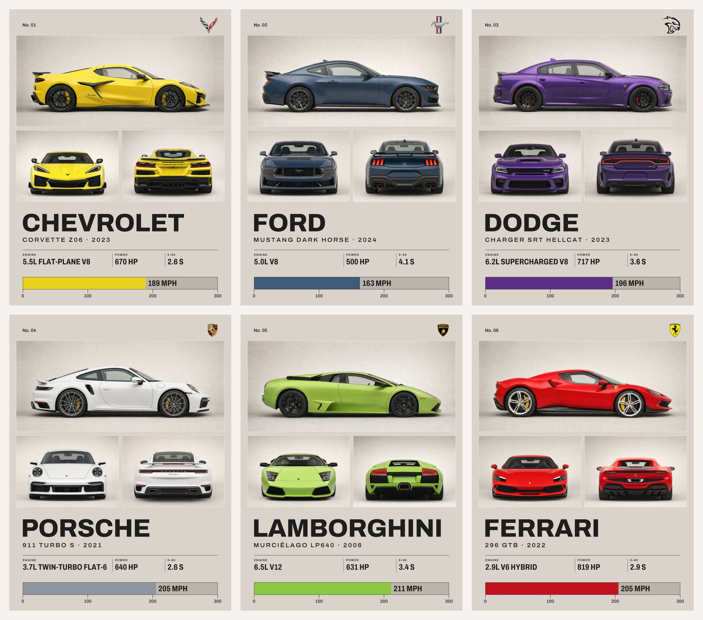

# Car posters

A simple Claude Code setup to generate professional car posters for my son's room.

Six cars with silhouettes he can learn to recognise, plus a bonus Ferrari F40. Each poster has a side profile, front and rear views, the maker's logo, a spec strip and a 0-300 mph top speed bar.

The repo carries 1800x2400 JPEG previews. The scripts produce the print files: 3600x4800 PNGs (12x16 in at 300 dpi) in `posters/print/`, which is gitignored because each one is 8-9 MB. `uv run compose.py --16x20 <slug>` lays the same grid out at 4:5 instead (3840x4800, 16x20 in at 240 dpi) in `posters/print/16x20/`; the extra width goes into the panels, not the margins.



The contact sheet shows 01-06; the F40 is separate. Its reference photos aren't included (no recorded source), so poster 07 can be viewed but not regenerated from a clone.

| No. | Car | Poster |
|---|---|---|
| 01 | Chevrolet Corvette Z06 (C8), 2023 | [01-z06.jpg](posters/01-z06.jpg) |
| 02 | Ford Mustang Dark Horse, 2024 | [02-darkhorse.jpg](posters/02-darkhorse.jpg) |
| 03 | Dodge Charger SRT Hellcat Widebody, 2023 | [03-charger.jpg](posters/03-charger.jpg) |
| 04 | Porsche 911 Turbo S (992), 2021 | [04-911turbos.jpg](posters/04-911turbos.jpg) |
| 05 | Lamborghini Murciélago LP640, 2006 | [05-murcielago.jpg](posters/05-murcielago.jpg) |
| 06 | Ferrari 296 GTB, 2022 | [06-296gtb.jpg](posters/06-296gtb.jpg) |
| 07 | Ferrari F40, 1987 (bonus) | [07-f40.jpg](posters/07-f40.jpg) |

## How it works

The image model only draws car photos. Everything else is code, because image models still garble text and numbers, and six separate generations never line up on their own.

1. `generate.py` sends gpt-image-2 (`images.edit`) a style reference plus 2-4 real photos of the car, and asks for one thing: a whole-poster layout for the side profile, or a single dead-on front or rear view. No text and no logos. The script's own estimate is about $0.53 per whole-poster candidate and $0.24 per view. It stops at a $45 budget.
2. `compose.py` builds the poster on a fixed grid. It finds the car in each image against the studio backdrop, using the tyres for the baseline so the floor shadow doesn't count. Then it scales and centres the car so every poster has the same car width and baseline, within 2 px. It sets the type in Archivo, places the real logo, draws the spec strip from `cars.json` and checks those values against `specs.md`.
3. After saving, `compose.py` re-measures each poster and writes `posters/measurements.json`. `measure_bar.py` reads the speed bar back off the image against the printed 0 and 300 ticks. Every bar measures within 0.5 mph of the printed top speed (the check passes within 1 mph).

`specs.md` has the numbers with sources, and a spotting note for each car (the Charger's full-width "racetrack" tail light, the 296's single centre exhaust) to point out when you look at the posters together.

I generated three whole-poster candidates per car and picked the hero profile by eye.

`CLAUDE.md` holds the workflow notes Claude Code reads.

## Layout

```
cars.json            car data, paint, prompt details, which generated images to use
specs.md             spec values with sources (compose.py checks against the table)
generate.py          image generation (OpenAI API)
compose.py           poster layout, type, logo, spec strip, speed bar
measure_bar.py       independent check of the speed bar
contact_sheet.py     builds the contact sheet
assets/              Archivo font (OFL) and the style reference image
logos/               logo files, prepare_logos.py, SOURCES.md
work/<car>/refs/     reference photos and credits.json
posters/             JPEG previews and measurements.json; print PNGs go in posters/print/
```

Generated images (`work/<car>/candidates/`, `work/<car>/views/`) aren't in the repo because they add about 95 MB. To rebuild a poster you generate your own and point `cars.json` at them.

## Running it

You need [uv](https://docs.astral.sh/uv/). Each script declares its dependencies inline, so `uv run` sets them up.

```sh
cp .env.example .env          # then put your OpenAI key in it, or export OPENAI_API_KEY

uv run generate.py 03-charger 3 --dry-run       # print the prompt and inputs, no API call
uv run generate.py 03-charger 3                 # three whole-poster candidates
uv run generate.py 03-charger 1 --view front    # one front view
uv run generate.py 03-charger 1 --view rear

# edit cars.json "art" to point at the images you picked, then
uv run compose.py 03-charger
uv run measure_bar.py posters/print/03-charger.png 196
uv run contact_sheet.py                         # needs the print files from compose
```

`logos/prepare_logos.py` rebuilds the logo PNGs from `logos/src/` and needs the cairo library (`brew install cairo` on macOS).

To add a car, add an entry to `cars.json` and a row to the table in `specs.md`, then put `side.jpg`, `front.jpg`, `rear.jpg` and, if you have one, `front34.jpg` in its `refs_dir`.

## Credits

The reference photos and logos belong to their respective owners. They're credited in `work/*/refs/credits.json` and `logos/SOURCES.md`, and are included only as generation references for a personal, non-commercial project. Car names and logos are trademarks of their makers. Archivo is by the Archivo Project Authors under the SIL Open Font License (`assets/fonts/OFL.txt`).
